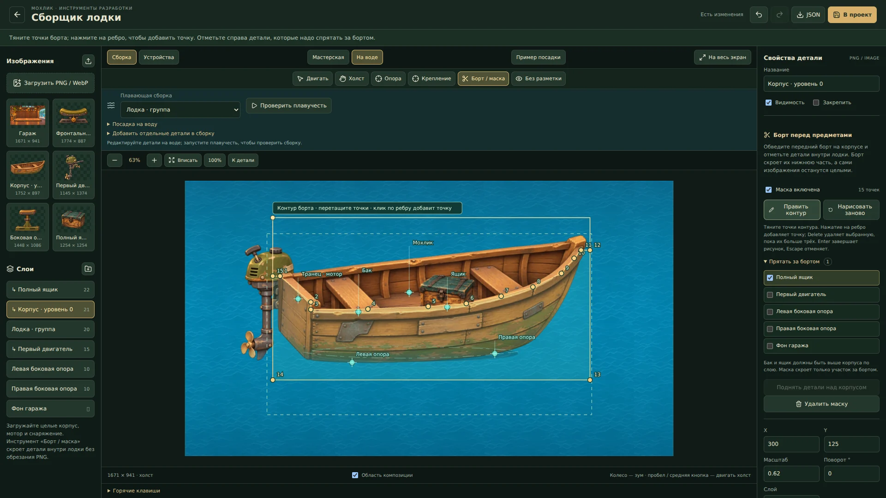

# Сборщик лодочной мастерской

Отдельный локальный инструмент разработки: `/prototype/boat-garage`. Запуск из корня через `npm run dev:local` (Next) или `npm run dev` (Vite). Также доступен по ссылке «Лодочная мастерская · сборщик» в DEV → Отладка → Приложение и тесты. В production страница и API возвращают 404.

Это подготовка графики и компоновки; сборщик пока не заменяет игровую мастерскую, не меняет экономику и не выполняет покупки. Нижняя панель внутри предпросмотра — макет будущего интерфейса.

## Большой холст и предпросмотр

По умолчанию открывается **«Сборка»**: весь центр занимает сцена гаража, без рамки телефона и макета игрового меню. **«На весь экран»** скрывает боковые панели; Esc возвращает обычный редактор. Колесо приближает точку под курсором, кнопки ±/100% меняют масштаб; «Вписать» показывает весь рисунок, «К детали» — выбранный слой. Пробел с перетаскиванием, средняя кнопка мыши или инструмент «Холст» перемещают рабочий вид.

Рабочие зум/перемещение не меняют JSON, камеры устройств, признак несохранённых изменений и историю. В режиме **«Устройства»** остаются телефон, маленький телефон, планшет и альбомный макет с отдельной нижней/правой UI-панелью. Инструмент «Камера» в этом режиме уже меняет сохраняемый кадр устройства.

**«Пример посадки»** загружает отдельный подготовленный пример с корпусом, мотором и боковыми стойками одним отменяемым действием. Текущую сцену возвращает Ctrl/⌘ Z; файл проекта не перезаписывается до «В проект». Браузерный черновик восстанавливается отдельно. Новые детали также доступны в библиотеке слева без загрузки всего примера: клик добавляет один экземпляр и подключает его изображение к текущей сборке. Начальный пустой шаблон и прежняя фронтальная стойка сохранены.

## Растягивание, поворот и перекрывающиеся слои

**G** (или прежняя V) включает перемещение, **R** — поворот, **S** — масштаб. После выбора режима тяните выбранную деталь на холсте: R вращает вокруг её опоры, S равномерно меняет размер вокруг той же опоры. Shift даёт шаг поворота 15° или масштаба 10%. Для свободного растягивания в S остаются восемь ручек по рамке. Сам выбор режима не меняет сцену и историю. Клавиши работают после нажатия кнопок панели и в русской раскладке; в текстовых полях остаётся обычный ввод. Ctrl/⌘ S сохраняет проект.

Выбранная незакреплённая деталь получает восемь ручек по рамке и отдельную круглую ручку поворота. Края меняют одну ось, углы — две; пропорции свободные. Shift сохраняет пропорции при растягивании и задаёт шаг 15° при повороте. Противоположный край/угол остаётся на месте. Отражение, скос и неравномерные родители учитываются; дочерние детали следуют иерархии. Каждый жест отменяется целиком.

Рамка выбранного слоя перехватывает перетаскивание даже тогда, когда изображение находится за другим предметом. Выбор больше не перескакивает на верхний корпус в момент начала движения или поворота. Для смены предмета используйте список слоёв либо Alt+клик; на сенсорном экране — список. Закреплённый фон не удерживает такой выбор. Числовые поля и инструменты точек остаются доступными для точной художественной расстановки.

## Правая панель

Вкладка **«Объект»** открывает координаты, масштаб, поворот и слой сразу под названием. Форма/отражение раскрываются отдельно, изображение выбирается ниже. **«Крепления»** содержит родителя, точки и подгонку контакта. **«Борт»** содержит настройки маски и её цели; M и верхняя кнопка маски открывают эту вкладку автоматически. У группы без изображения показано объяснение, почему ей нельзя назначить контур борта.

Название, видимость, закрепление и вкладки остаются в верхней части инспектора при прокрутке, дубликат/удаление — в нижней. Вкладки переключаются стрелками, Home/End; это состояние интерфейса, оно не добавляет undo и не меняет JSON. Настройки подгонки сохраняются при переходах между вкладками. На узком экране свойства находятся сразу после холста, перед библиотекой, и прокручиваются вместе со страницей.

## Целые предметы внутри лодки: маска переднего борта

Бак, ящик и персонажа загружайте целыми изображениями с прозрачным фоном. Маска не обрезает PNG: корпус скрывает только выбранные предметы в пределах нарисованного переднего борта. Когда предмет перемещается выше или наружу, скрытые участки снова видны. Уже вырезанные из общей картинки фрагменты не получают отсутствующую графику автоматически.

1. Выберите **изображение корпуса** в списке слоёв. Нажмите **«Борт / маска»** над холстом или **«Создать контур борта»** справа. Начальный контур покрывает нижнюю часть картинки.
2. Перетаскивайте жёлтые точки по переднему борту. Нажатие на ребро вставляет точку; Delete/Backspace удаляет выбранную, пока остаются хотя бы три. Контур может быть вогнутым, но не должен пересекать себя. Максимум — 64 точки. Некорректное движение не заменяет последний корректный контур.
3. В **«Прятать за бортом»** отметьте бак, ящик или группу со всеми её потомками. Сам корпус и его предки недоступны, чтобы не скрыть корпус собственной маской. Неотмеченные предметы остаются прежними.
4. Предмет должен рисоваться выше корпуса по `zIndex`, иначе корпус уже закрывает его целиком обычным порядком слоёв. **«Поднять детали над корпусом»** поднимает отмеченные ветви одним отменяемым действием. Закреплённые слои сохраняют свой порядок; при необходимости снимите закрепление отдельно.
5. **«Нарисовать заново»** позволяет набрать новый контур кликами по изображению. Enter, двойной клик или клик по первой точке замыкают его. Escape либо выход из инструмента отменяет незавершённый рисунок; до применения действует старый контур. Ctrl/⌘ Z/Y отменяет/возвращает точки рисунка. Сохранение и JSON временно недоступны, чтобы не выдать старый контур за новый.
6. **«Без разметки»** показывает результат. Флажок **«Маска включена»** временно отключает перекрытие, сохраняя точки и цели; **«Удалить маску»** убирает только маску. Создание, изменение, включение, список целей и удаление отменяются обычной историей; перетаскивание точки — один жест.

Маска принадлежит корпусу и следует его повороту, масштабу, скосу, отражению и родителям. Используется исходная альфа корпуса: прозрачные места внутри контура не скрывают предмет. Невидимый корпус или скрытый родитель не перекрывает детали; в водном предпросмотре также учитывается состав плавающей сборки. Маски работают в обоих режимах холста и устройств, в том числе при общей качке. Рамки и ручки выбранного предмета остаются доступными поверх борта.

Настройки сохраняются в необязательном поле слоя `occlusion: { enabled, points, targetIds }`: точки нормированы к размерам изображения от 0 до 1, цели заданы ID слоёв. Старые сцены без этого поля остаются прежними. При удалении цели её ID удаляется из масок; оригинальные изображения и координаты остальных слоёв сохраняются. Для другого уровня корпуса с новым рисунком проверьте контур заново: инструмент не определяет форму борта по картинке автоматически.

## Редактирование на воде

Переключатель **«На воде»** заменяет фон студии водой и показывает выбранную **«Плавающую сборку»** со всеми её дочерними деталями. Гараж и отдельные стойки скрываются только в этом предпросмотре; исходные слои сохраняются. В примере выбирается «Лодка · группа», мотор входит в неё через корпус.

Если корпус и мотор были импортированы раздельно, раскройте **«Добавить отдельные детали в сборку»**, отметьте нужные слои и нажмите **«Добавить в плавающую сборку»**. Меняется родительство с сохранением мировой позиции, формы и порядка слоёв; одно действие можно отменить. Автоматического включения предметов по названию нет. Предки выбранной группы, закреплённые и уже входящие детали исключены. Если одновременно отмечены группа и её ребёнок, группа переносится один раз вместе с ним.

В неподвижном режиме можно двигать, растягивать и поворачивать детали прямо на воде. **«Посадка на воду»** задаёт уровень воды Y, ширину плавучей части и силу волн. По умолчанию корпус показывается чисто: тень/рябь/пена и полупрозрачное погружение выключены, в том числе для старых сцен без новых настроек. В **«Эффекты у корпуса»** их можно включить отдельно, задать интенсивность и смещение ряби/пены/тени по Y. Это смещение не двигает лодку и не меняет ватерлинию или качку. Оригинальные PNG сохраняются.

**«Проверить плавучесть»** запускает общую качку всей группы. В двух точках берётся высота волны; демпфированная модель рассчитывает вертикальное движение и крен фиксированными шагами 1/120 с. Мотор/ящик не качаются каждый сам по себе. **«Пауза и редактировать»** возвращает точную авторскую позу и ручки; анимация не попадает в JSON, undo или черновик. Изменение свойства также останавливает качку. Массу/объём отдельных предметов этот визуальный прототип пока не моделирует; это следующий этап игровой физики.

Настройки `waterPreview` сохраняются в JSON как `{rootId, waterlineY, beam, amplitude}` и необязательные `effectsEnabled`, `effectOpacity` (0–1), `effectOffsetY` (−2000…2000), `immersionEnabled`. Отсутствующие поля старого файла не добавляются при загрузке. Само переключение окружения и запуск/пауза не делают сцену изменённой. При удалении плавающей группы настройки очищаются. При скрытой вкладке и системном reduced motion останавливаются RAF и CSS-анимации. В узком альбомном полноэкранном режиме второстепенные панели убираются, оставляя место холсту. Режим студии не заменяет действующую игровую мастерскую или рыбалку автоматически.

## Расстановка и подгонка

1. Выберите слой на сцене или в списке. Двигайте мышью/касанием, стрелками — на 1, Shift+стрелками — на 10 единиц. Общий масштаб, поворот и порядок рисования находятся справа. Фон закреплён по умолчанию.
2. **«Форма и отражение»** задаёт ширину и высоту независимо, отражение X/Y и скос. У стойки в примере опорная точка находится на подошве, поэтому изменение высоты поднимает верх, оставляя ногу на платформе. Сильным растяжением/скосом нельзя исправить ракурс изображения.
3. Инструмент **«Опора»** задаёт жёлтую точку самой детали; её перенос не сдвигает изображение, крепления или дочерние детали. **«Крепление»** создаёт именованную бирюзовую точку. Прозрачные поля входят в исходные размеры: точку контакта ставьте на нарисованной поверхности, а не на краю PNG.
4. **«Подгонка контакта»** совмещает выбранную точку детали с точкой другого слоя в мировых координатах, сохраняя независимость слоёв. Для стойки выберите её «Контакт с корпусом», слой корпуса и «Левая/Правая опора», затем «Совместить точки». Это разовая расстановка, а не привязка к лодке; после неё проверьте подошву и при необходимости подстройте высоту.
5. Опция **«По двум точкам»** дополнительно подгоняет общий размер и поворот: две разные точки детали совмещаются с двумя разными точками выбранного слоя. Совпадающие исходные/целевые точки отвергаются. Не вращайте всю стойку ради наклона днища: вертикальный винт и ровное основание должны оставаться правдоподобными.
6. Для мотора и перевозимых модулей можно задать **родителя** и его крепление. Смена родителя сохраняет вид, включая неравномерный масштаб/отражение/скос; «Совместить с креплением» ставит опорную точку точно на крепление. Дети наследуют преобразование лодки. Стойки гаража оставляйте независимыми. Удаление группы удаляет её потомков; дубликат копирует один слой.
7. **«Без разметки»** показывает рисунок без рамок и точек. «В проект» сохраняет сцену, JSON экспортируется/импортируется отдельно и содержит пути, не сами изображения. После перезагрузки редактор предлагает восстановить черновик с исходной revision; более свежая дисковая версия не перезаписывается молча.

## Почему прежние стойки не совпадали

Старая широкая U-образная стойка нарисована спереди, а корпус — почти сбоку; у них разные камеры. Кроме того, правый участок днища выше левого, а прозрачное поле под подошвой прежней стойки мешало привязке к нижнему краю файла. Одинаковые стойки на одной высоте не создают правильную посадку.

В новом примере применены боковые винтовые опоры. Их подошвы стоят на одной линии платформы, высота различается, верх чуть перекрывается корпусом. Точки контакта заданы по настоящему нижнему контуру корпуса. Мотор закреплён на транце и рисуется за корпусом. Пример показывает пригодную сборку; контакты и размеры остаются редактируемыми.

Для следующих изображений **корпус задаёт общий ракурс, свет и пропорции**; его нужно передавать как референс детали. Если зажим, опора или персонаж одновременно находятся перед корпусом и за ним, используйте новую маску борта либо отдельные передний/задний слои. Один `zIndex` не разделяет изображение, а анкеры не поворачивают нарисованный предмет в 3D. В исходном примере верх опоры и задняя часть моторного крепления просто перекрываются корпусом; маска добавляется автором отдельно, чтобы готовый пример и пользовательская сцена не менялись автоматически.

## Горячие клавиши

| Клавиши | Действие |
|---|---|
| Ctrl/⌘ Z | Отменить |
| Ctrl/⌘ Shift Z или Ctrl/⌘ Y | Повторить |
| Ctrl/⌘ D | Дубликат выбранного слоя |
| Ctrl/⌘ S | Сохранить в проект на локальном dev-сервере |
| Стрелки / Shift + стрелки | Сдвиг на 1 / 10 единиц относительно родителя |
| Delete / Backspace | Удалить выбранный незакреплённый слой |
| G или V / R / S | Перемещение / поворот / масштаб; затем перетаскивание детали |
| H / P / A / M | Холст или камера / опора / крепление / маска борта |
| Shift при перетаскивании детали в R/S | Шаг 15° / 10% масштаба |
| Shift + ручка рамки / поворота | Сохранять пропорции / шаг поворота 15° |
| Alt + клик | Выбрать другой слой под рамкой текущей детали |
| Пробел + drag / средняя кнопка | Переместить рабочий холст |
| Esc | Вернуть панели, выйти из чистого просмотра и включить перемещение |
| Enter / двойной клик при рисовании маски | Применить новый контур |
| Delete / Backspace в маске | Удалить выбранную точку; корпус не удаляется |
| Ctrl/⌘ Z/Y при рисовании нового контура | Отменить / вернуть точку рисунка |
| Escape в инструменте маски | Отменить незавершённый рисунок и выйти из инструмента |

Физические клавиши работают в русской и английской раскладке. В полях остаются обычные команды редактирования; для отмены расстановки выйдите из поля или нажмите кнопку отмены. Команда во время перетаскивания завершает жест, последующее движение мыши не перезаписывает отмену. История хранит до 100 действий; drag и удержание стрелки отменяются целиком.

## Экран PWA

Квадратная карта мира не задаёт пропорции мастерской. Сцена и интерфейс разделены: телефон показывает центральный кадр гаража примерно 4:3, планшет — более широкий кадр 16:9. В альбомном режиме панель находится справа. Изображения не растягиваются непропорционально; обрезается декор по краям, а детали используют одну систему координат. Панель прокручивается отдельно от сцены, верхний и нижний отступы устройства видны в предпросмотре.

Инструмент «Камера» двигает кадр без смещения деталей. Числовые настройки камеры находятся под предпросмотром. Портретная и широкая камеры сохраняются отдельно. Рамка безопасной области — ориентир для центральной композиции; окончательную видимость проверяйте на каждом устройстве.

## Источники и сохранение

| Данные | Файл |
|---|---|
| Пустой шаблон сцены | `features/world/dev/boat-garage/garage-scene-default.json` |
| Пример корректной посадки | `features/world/dev/boat-garage/garage-scene-example.json` |
| Сохранённая сборка, приоритет над шаблоном | `art/world/boat-garage/scene.json` |
| Мастера начальных изображений | `art/world/boat-garage/garage.png`, `stand.png` |
| Браузерные версии | `public/world/boat-garage/garage.webp`, `stand.webp` |
| Новые импортированные изображения | одинаковые `asset-<sha256>.*` в `art/world/boat-garage/` и `public/world/boat-garage/` |
| Новые модульные рисунки / их контакты | `art/world/boat-garage/{starter-hull,starter-motor,stand-side}.png`, `modular-parts.json`; WebP в `public/world/boat-garage/` |
| Ручки преобразования | `garage-transform.mjs`; полный мировой affine-transform и единый undo жеста |
| Маска борта | `garage-occlusion.mjs`, `garage-occlusion-controls.tsx`, `garage-occlusion-overlay.tsx`, `garage-artwork.tsx`; точки/цели, редактирование и выборочное перекрытие с исходной альфой |
| Вода и общая плавучесть | `garage-water.tsx`, `garage-water-motion.mjs`, `garage-water-setup.mjs`, `garage-water-assembly.mjs`, `garage-water-controls.tsx` |
| Рабочий зум и кадрирование | `garage-editor-view.mjs`; состояние только редактора |
| Типы и геометрия | `features/world/dev/boat-garage/garage-scene-types.ts`, `garage-scene-model.mjs` |
| Интерфейс | `garage-editor.tsx`, `garage-stage.tsx`, `garage-inspector.tsx`, `garage-inspector.module.css`, `garage-editor-shortcuts.mjs`, соседний CSS |
| Next API / Vite Node host | `app/api/dev/boat-garage/route.ts`, `build/boat-garage-project-files-plugin.mjs` |
| Файловое сохранение | `lib/dev/boat-garage-project-files.mjs` |

API работает только в development на localhost/частном LAN-адресе; запись требует совпадения Origin и Host. Vite использует Node-host middleware, поскольку Cloudflare Worker не пишет в checkout. Внешний прокси-предпросмотр может показывать редактор и экспортировать JSON, но не получает права записи в локальные файлы. Шаблон и импортированный JSON проверяются: ссылки на родителей, циклы, размеры, число объектов, локальные пути изображений. При конфликте сохранения сервер возвращает 409. Изображения ограничены одним кадром PNG/WebP/JPEG, 10 МиБ, 4096×4096 и 16 млн пикселей; оригинальные байты и альфа сохраняются.

Целевые проверки: `node --test tests/garage-*.test.mjs`, затем `npm run typecheck`, `npm run architecture:check`, `npm run lint`. Сборки Sites и Next/VPS выполняйте последовательно. Реальный телефон, Safari/PWA и подключение к игровой мастерской остаются отдельным этапом.
