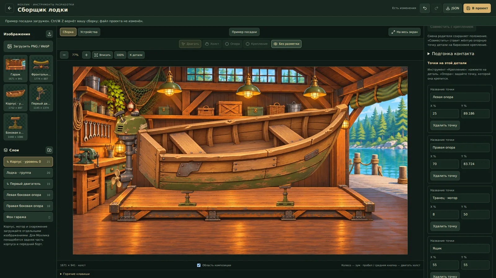

# Сборщик лодочной мастерской

Отдельный локальный инструмент разработки: `/prototype/boat-garage`. Запуск из корня через `npm run dev:local` (Next) или `npm run dev` (Vite). Также доступен по ссылке «Лодочная мастерская · сборщик» в DEV → Отладка → Приложение и тесты. В production страница и API возвращают 404.

Это подготовка графики и компоновки; сборщик пока не заменяет игровую мастерскую, не меняет экономику и не выполняет покупки. Нижняя панель внутри предпросмотра — макет будущего интерфейса.

## Большой холст и предпросмотр

По умолчанию открывается **«Сборка»**: весь центр занимает сцена гаража, без рамки телефона и макета игрового меню. **«На весь экран»** скрывает боковые панели; Esc возвращает обычный редактор. Колесо приближает точку под курсором, кнопки ±/100% меняют масштаб; «Вписать» показывает весь рисунок, «К детали» — выбранный слой. Пробел с перетаскиванием, средняя кнопка мыши или инструмент «Холст» перемещают рабочий вид.

Рабочие зум/перемещение не меняют JSON, камеры устройств, признак несохранённых изменений и историю. В режиме **«Устройства»** остаются телефон, маленький телефон, планшет и альбомный макет с отдельной нижней/правой UI-панелью. Инструмент «Камера» в этом режиме уже меняет сохраняемый кадр устройства.

**«Пример посадки»** загружает отдельный подготовленный пример с корпусом, мотором и боковыми стойками одним отменяемым действием. Текущую сцену возвращает Ctrl/⌘ Z; файл проекта не перезаписывается до «В проект». Браузерный черновик восстанавливается отдельно. Новые детали также доступны в библиотеке слева без загрузки всего примера: клик добавляет один экземпляр и подключает его изображение к текущей сборке. Начальный пустой шаблон и прежняя фронтальная стойка сохранены.

## Расстановка и подгонка

1. Выберите слой на сцене или в списке. Двигайте мышью/касанием, стрелками — на 1, Shift+стрелками — на 10 единиц. Общий масштаб, поворот и порядок рисования находятся справа. Фон закреплён по умолчанию.
2. **«Форма и отражение»** задаёт ширину и высоту независимо, отражение X/Y и скос. У стойки в примере опорная точка находится на подошве, поэтому изменение высоты поднимает верх, оставляя ногу на платформе. Сильным растяжением/скосом нельзя исправить ракурс изображения.
3. Инструмент **«Опора»** задаёт жёлтую точку самой детали; её перенос не сдвигает изображение, крепления или дочерние детали. **«Крепление»** создаёт именованную бирюзовую точку. Прозрачные поля входят в исходные размеры: точку контакта ставьте на нарисованной поверхности, а не на краю PNG.
4. **«Подгонка контакта»** совмещает выбранную точку детали с точкой другого слоя в мировых координатах, сохраняя независимость слоёв. Для стойки выберите её «Контакт с корпусом», слой корпуса и «Левая/Правая опора», затем «Совместить точки». Это разовая расстановка, а не привязка к лодке; после неё проверьте подошву и при необходимости подстройте высоту.
5. Опция **«По двум точкам»** дополнительно подгоняет общий размер и поворот: две разные точки детали совмещаются с двумя разными точками выбранного слоя. Совпадающие исходные/целевые точки отвергаются. Не вращайте всю стойку ради наклона днища: вертикальный винт и ровное основание должны оставаться правдоподобными.
6. Для мотора и перевозимых модулей можно задать **родителя** и его крепление. Смена родителя сохраняет вид, включая неравномерный масштаб/отражение/скос; «Совместить с креплением» ставит опорную точку точно на крепление. Дети наследуют преобразование лодки. Стойки гаража оставляйте независимыми. Удаление группы удаляет её потомков; дубликат копирует один слой.
7. **«Без разметки»** показывает рисунок без рамок и точек. «В проект» сохраняет сцену, JSON экспортируется/импортируется отдельно и содержит пути, не сами изображения. После перезагрузки редактор предлагает восстановить черновик с исходной revision; более свежая дисковая версия не перезаписывается молча.

## Почему прежние стойки не совпадали

Старая широкая U-образная стойка нарисована спереди, а корпус — почти сбоку; у них разные камеры. Кроме того, правый участок днища выше левого, а прозрачное поле под подошвой прежней стойки мешало привязке к нижнему краю файла. Одинаковые стойки на одной высоте не создают правильную посадку.

В новом примере применены боковые винтовые опоры. Их подошвы стоят на одной линии платформы, высота различается, верх чуть перекрывается корпусом. Точки контакта заданы по настоящему нижнему контуру корпуса. Мотор закреплён на транце и рисуется за корпусом. Пример показывает пригодную сборку; контакты и размеры остаются редактируемыми.

Для следующих изображений **корпус задаёт общий ракурс, свет и пропорции**; его нужно передавать как референс детали. Если зажим, опора или персонаж одновременно находятся перед корпусом и за ним, нужны отдельные передний/задний слои либо маска. Один `zIndex` не разделяет изображение, а анкеры не поворачивают нарисованный предмет в 3D. В примере верх опоры и задняя часть моторного крепления просто перекрываются корпусом; окончательное обхватывающее крепление потребует разделённой графики.

## Горячие клавиши

| Клавиши | Действие |
|---|---|
| Ctrl/⌘ Z | Отменить |
| Ctrl/⌘ Shift Z или Ctrl/⌘ Y | Повторить |
| Ctrl/⌘ D | Дубликат выбранного слоя |
| Ctrl/⌘ S | Сохранить в проект на локальном dev-сервере |
| Стрелки / Shift + стрелки | Сдвиг на 1 / 10 единиц относительно родителя |
| Delete / Backspace | Удалить выбранный незакреплённый слой |
| V / H / P / A | Перемещение / холст или камера / опора / крепление |
| Пробел + drag / средняя кнопка | Переместить рабочий холст |
| Esc | Вернуть панели, выйти из чистого просмотра и включить перемещение |

Физические клавиши работают в русской и английской раскладке. В полях остаются обычные команды редактирования; для отмены расстановки выйдите из поля или нажмите кнопку отмены. Команда во время перетаскивания завершает жест, последующее движение мыши не перезаписывает отмену. История хранит до 100 действий; drag и удержание стрелки отменяются целиком.

## Экран PWA

Квадратная карта мира не задаёт пропорции мастерской. Сцена и интерфейс разделены: телефон показывает центральный кадр гаража примерно 4:3, планшет — более широкий кадр 16:9. В альбомном режиме панель находится справа. Изображения не растягиваются непропорционально; обрезается декор по краям, а детали используют одну систему координат. Панель прокручивается отдельно от сцены, верхний и нижний отступы устройства видны в предпросмотре.

Инструмент «Камера» двигает кадр без смещения деталей. Числовые настройки камеры находятся под предпросмотром. Портретная и широкая камеры сохраняются отдельно. Рамка безопасной области — ориентир для центральной композиции; окончательную видимость проверяйте на каждом устройстве.

## Источники и сохранение

| Данные | Файл |
|---|---|
| Пустой шаблон сцены | `features/world/dev/boat-garage/garage-scene-default.json` |
| Пример корректной посадки | `features/world/dev/boat-garage/garage-scene-example.json` |
| Сохранённая сборка, приоритет над шаблоном | `art/world/boat-garage/scene.json` |
| Мастера начальных изображений | `art/world/boat-garage/garage.png`, `stand.png` |
| Браузерные версии | `public/world/boat-garage/garage.webp`, `stand.webp` |
| Новые импортированные изображения | одинаковые `asset-<sha256>.*` в `art/world/boat-garage/` и `public/world/boat-garage/` |
| Новые модульные рисунки / их контакты | `art/world/boat-garage/{starter-hull,starter-motor,stand-side}.png`, `modular-parts.json`; WebP в `public/world/boat-garage/` |
| Рабочий зум и кадрирование | `garage-editor-view.mjs`; состояние только редактора |
| Типы и геометрия | `features/world/dev/boat-garage/garage-scene-types.ts`, `garage-scene-model.mjs` |
| Интерфейс | `garage-editor.tsx`, `garage-stage.tsx`, `garage-inspector.tsx`, `garage-editor-shortcuts.mjs`, соседний CSS |
| Next API / Vite Node host | `app/api/dev/boat-garage/route.ts`, `build/boat-garage-project-files-plugin.mjs` |
| Файловое сохранение | `lib/dev/boat-garage-project-files.mjs` |

API работает только в development на localhost/частном LAN-адресе; запись требует совпадения Origin и Host. Vite использует Node-host middleware, поскольку Cloudflare Worker не пишет в checkout. Внешний прокси-предпросмотр может показывать редактор и экспортировать JSON, но не получает права записи в локальные файлы. Шаблон и импортированный JSON проверяются: ссылки на родителей, циклы, размеры, число объектов, локальные пути изображений. При конфликте сохранения сервер возвращает 409. Изображения ограничены одним кадром PNG/WebP/JPEG, 10 МиБ, 4096×4096 и 16 млн пикселей; оригинальные байты и альфа сохраняются.

Целевые проверки: `node --test tests/garage-*.test.mjs`, затем `npm run typecheck`, `npm run architecture:check`, `npm run lint`. Сборки Sites и Next/VPS выполняйте последовательно. Реальный телефон, Safari/PWA и подключение к игровой мастерской остаются отдельным этапом.
