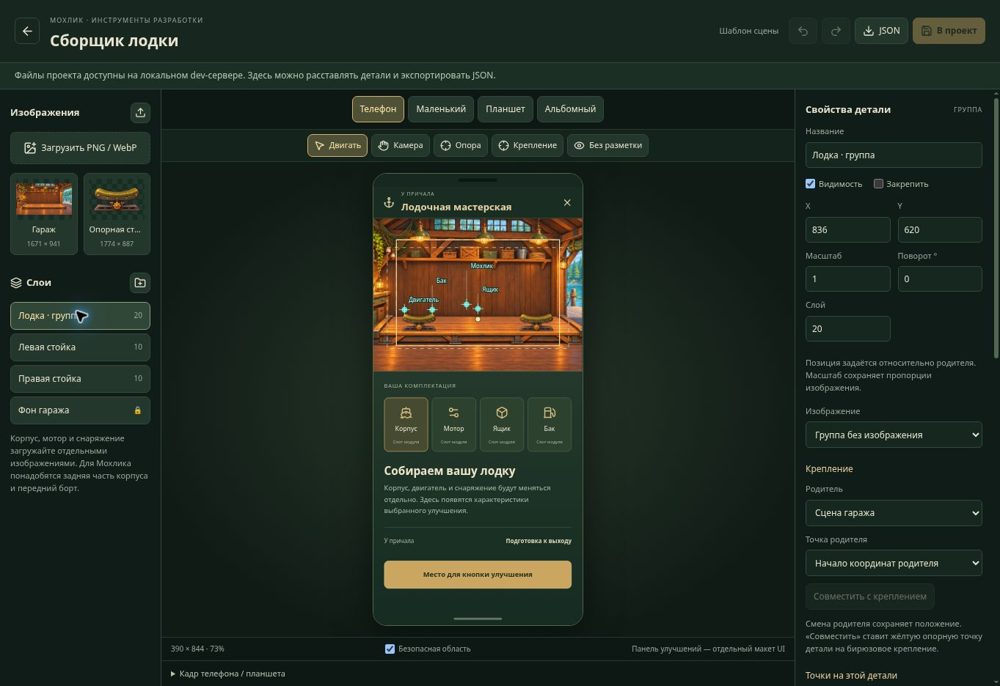

# Сборщик лодочной мастерской

Отдельный локальный инструмент разработки: `/prototype/boat-garage`. Запуск из корня через `npm run dev:local` (Next) или `npm run dev` (Vite). Также доступен по ссылке «Лодочная мастерская · сборщик» в DEV → Отладка → Приложение и тесты. В production страница и API возвращают 404.

Это подготовка графики и компоновки; сборщик пока не заменяет игровую мастерскую, не меняет экономику и не выполняет покупки. Нижняя панель внутри предпросмотра — макет будущего интерфейса.

## Работа

1. Начальная сцена содержит фон гаража, две независимые стойки и пустую группу лодки. Загрузите корпус или другую деталь через «Загрузить PNG / WebP»; JPEG также поддерживается. Мотор, ящик и бак загружайте отдельно. Для размещения персонажа внутри лодки подготовьте заднюю часть корпуса и передний борт отдельными слоями.
2. Выберите деталь в списке слоёв или на сцене. Перетаскивайте мышью/касанием; масштаб, поворот и порядок рисования задаются справа. Стрелки при фокусе сцены сдвигают деталь, Shift увеличивает шаг. Фон по умолчанию закреплён.
3. Выберите «Крепление», затем нажмите на выбранную деталь: появится бирюзовая точка. «Опора» задаёт жёлтую точку самой детали без скачка её положения. Названия и проценты координат креплений доступны в свойствах.
4. Для мотора выберите родителя (корпус или группа лодки), нужное крепление и «Совместить с креплением». Смена родителя сохраняет текущий вид, совмещение обнуляет смещение от крепления. Перемещение/масштаб/поворот родителя действует на его детали. Стойки остаются независимыми от лодки. Удаление группы удаляет её потомков; дублирование копирует один слой.
5. «Телефон», «Маленький», «Планшет», «Альбомный» переключают реальные размеры виртуального экрана. «Без разметки» показывает композицию без редакторских рамок. Отмена/повтор доступны кнопками; Ctrl/Cmd+Z и Shift+Ctrl/Cmd+Z действуют вне полей ввода.
6. «В проект» сохраняет сцену на диск. JSON можно экспортировать или импортировать отдельно; он содержит пути, а не сами изображения. После перезагрузки редактор предлагает восстановить браузерный черновик. У старого черновика сохраняется его базовая revision, поэтому более свежая дисковая версия не перезаписывается молча.

Изображения должны иметь одинаковые перспективу и направление света. Крепления задают геометрию сборки, но не исправляют несовпадающие ракурсы. Прозрачные поля входят в размеры изображения: меняйте опору/крепление с учётом этих полей.

## Экран PWA

Квадратная карта мира не задаёт пропорции мастерской. Сцена и интерфейс разделены: телефон показывает центральный кадр гаража примерно 4:3, планшет — более широкий кадр 16:9. В альбомном режиме панель находится справа. Изображения не растягиваются непропорционально; обрезается декор по краям, а детали используют одну систему координат. Панель прокручивается отдельно от сцены, верхний и нижний отступы устройства видны в предпросмотре.

Инструмент «Камера» двигает кадр без смещения деталей. Числовые настройки камеры находятся под предпросмотром. Портретная и широкая камеры сохраняются отдельно. Рамка безопасной области — ориентир для центральной композиции; окончательную видимость проверяйте на каждом устройстве.

## Источники и сохранение

| Данные | Файл |
|---|---|
| Шаблон сцены | `features/world/dev/boat-garage/garage-scene-default.json` |
| Сохранённая сборка, приоритет над шаблоном | `art/world/boat-garage/scene.json` |
| Мастера начальных изображений | `art/world/boat-garage/garage.png`, `stand.png` |
| Браузерные версии | `public/world/boat-garage/garage.webp`, `stand.webp` |
| Новые импортированные изображения | одинаковые `asset-<sha256>.*` в `art/world/boat-garage/` и `public/world/boat-garage/` |
| Типы и геометрия | `features/world/dev/boat-garage/garage-scene-types.ts`, `garage-scene-model.mjs` |
| Интерфейс | `garage-editor.tsx`, `garage-stage.tsx`, `garage-inspector.tsx`, соседний CSS |
| Next API / Vite Node host | `app/api/dev/boat-garage/route.ts`, `build/boat-garage-project-files-plugin.mjs` |
| Файловое сохранение | `lib/dev/boat-garage-project-files.mjs` |

API работает только в development на localhost/частном LAN-адресе; запись требует совпадения Origin и Host. Vite использует Node-host middleware, поскольку Cloudflare Worker не пишет в checkout. Внешний прокси-предпросмотр может показывать редактор и экспортировать JSON, но не получает права записи в локальные файлы. Шаблон и импортированный JSON проверяются: ссылки на родителей, циклы, размеры, число объектов, локальные пути изображений. При конфликте сохранения сервер возвращает 409. Изображения ограничены одним кадром PNG/WebP/JPEG, 10 МиБ, 4096×4096 и 16 млн пикселей; оригинальные байты и альфа сохраняются.

Целевые проверки: `node --test tests/garage-*.test.mjs`, затем `npm run typecheck`, `npm run architecture:check`, `npm run lint`. Сборки Sites и Next/VPS выполняйте последовательно. Реальный телефон, Safari/PWA и подключение к игровой мастерской остаются отдельным этапом.
