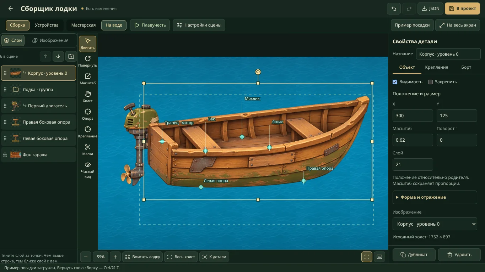

# Сборщик лодочной мастерской

## Боковые сборки L0–L5 · 9 ноября 2026

В игровой мастерской и боковых пресетах корпус лежит на двух отдельных винтовых опорах. Широкая деревянная подушка опирается на короткий латунный винт, а поперечная стяжка соединяет ноги стальной рамы. В стартовой сцене и боковых пресетах от пола до подушки 160 единиц. В студии выберите «Лодка сбоку · L0–L5», чтобы увидеть новую расстановку. Сохранённые сцены и черновики сохраняют выставленные координаты.

Мастер `art/world/boat-garage/stand-side.svg` можно открыть в Illustrator: рама, подошвы, винт, рукоятка и седловина разделены на именованные группы. Холст 320×320, контакт с килем `(160,24)`, точка пола `(160,304)`. Не обрезайте холст при сохранении. После правки выполните `node scripts/prepare-boat-scene-assets.mjs`: он обновит браузерную SVG-копию. Позиции новых сборок общие с игрой в `features/world/objects/fishing-boat/fishing-boat-garage-layout.mjs`; в редакторе их можно менять мышью, стрелками и численно. На воде подставки не рисуются.

В левой панели появился выбор «Лодка сбоку · L0–L5». Он создаёт отдельный отменяемый пример с утверждённым корпусом, мотором и баком; прежний проект и черновики не заменяются автоматически. Все 18 SVG доступны в библиотеке, уровни разных деталей совместимы благодаря общим креплениям. Две боковые опоры стоят под килем независимо от лодки и не попадают в плавающую группу при переходе «На воде». Хранилище остаётся прокачкой без изображения ящика.

Обновлённый фон мастерской и новая вода общие с игровыми гаражом и рыбалкой. Мастера и команды подготовки описаны в [каталоге графики](../../art/world/boat/README.md). Встроенные SVG разрешены только по узкому списку файлов `/world/boat/modular/` и точному пути `/world/boat-garage/stand-side.svg`; загрузка произвольных SVG не включена.

В новых боковых сборках контакт с водой включён сразу: линия воды `620.2`, погружение и эффекты активны. Вода пересекает нижний край корпуса и винт, а рисунок отражается отдельными полосами; прежний овал под лодкой убран. Маска использует настоящую прозрачность деталей, поэтому вода не заливает пустой прямоугольник сборки. Поверхность волн остаётся в мировых координатах при качке. Существующие сохранённые настройки не заменяются: для старой сцены настройте погружение и эффекты в панели воды либо выберите новый боковой пресет. Разделение рендера — `garage-water-presentation.tsx` и `garage-water-contact.mjs`; отражение использует один повторный проход рисунка.

Откройте `/prototype/boat-garage` после `npm run dev:local` (Next) или `npm run dev` (Vite). Из игры откройте DEV → Отладка → Приложение и тесты → «Лодочная мастерская · сборщик». Страница и API доступны в режиме разработки. Здесь собирают сцену из изображений и проверяют, как лодка выглядит на воде и на разных экранах.

## Холст и панели

В режиме **«Сборка»** холст занимает центр окна. Слева находятся слои и библиотека, справа — свойства детали. На узком экране используйте нижние кнопки **«Слои»**, **«Холст»** и **«Свойства»**. **«На весь экран»** отдаёт сцене место боковых панелей. Esc возвращает панели. Откройте **«Настройки сцены»**, чтобы отрегулировать воду или кадр устройства и сразу увидеть результат.

Колесо приближает точку под курсором. Для перемещения холста удерживайте пробел и тяните мышью, используйте среднюю кнопку или инструмент «Холст». Кнопки ± и 100% меняют рабочий масштаб. В мастерской **«Вписать»** показывает весь холст. При переходе **«На воде»** редактор приближает плавающую сборку. Вернуться к этому виду можно кнопкой **«Вписать лодку»**, к границам сцены — кнопкой **«Весь холст»**. **«К детали»** кадрирует выделенный слой. Для группы в кадр попадут её видимые изображения, для пустой группы — собственная рамка. Выбранный вручную масштаб сохраняется при редактировании и относится только к рабочему холсту.

В режиме **«Устройства»** выберите телефон, маленький телефон, планшет или альбомный экран. Внутри рамки находится макет игрового меню. По умолчанию устройство помещается в окно целиком. Включите **«1:1»**, чтобы увидеть натуральный размер и прокручивать макет внутри окна. Для изменения сохраняемого кадра используйте инструмент «Камера» или числовые поля в «Настройках сцены».

**«Пример посадки»** загружает подготовленные корпус, мотор и боковые стойки и приближает собранную лодку. Ctrl/⌘ Z возвращает прежнюю сцену. Чтобы записать сборку на диск, нажмите «В проект».

## Порядок слоёв

1. Откройте **«Слои»** и выберите строку детали. Верхние строки рисуются перед нижними.
2. Перетащите строку выше или ниже нужной детали. На сенсорном экране тяните за точки слева. Отпустите у линии вставки. На клавиатуре сфокусируйте строку и нажмите **Alt + ↑ / ↓**. Есть также кнопки **«Поднять слой»** и **«Опустить слой»** над списком.
3. Чтобы переместить всю лодку по глубине, тяните строку **группы**. Она переносит все вложенные слои вместе в их прежнем порядке. Перетаскивание строки изображения меняет глубину только этой детали. Положение, крепления и родитель сохраняются. Один жест отменяется через Ctrl/⌘ Z.

Замок у строки означает, что слой или часть группы закреплены. Для смены родителя откройте «Свойства» → «Крепления». Кнопка с папкой над списком добавляет группу. Вкладка **«Изображения»** позволяет добавить экземпляр готовой детали одним нажатием, загрузить своё изображение или импортировать сборку из JSON.

## Растягивание, поворот и перекрывающиеся слои

**G** (или прежняя V) включает перемещение, **R** — поворот, **S** — масштаб. После выбора режима тяните выбранную деталь на холсте: R вращает вокруг её опоры, S равномерно меняет размер вокруг той же опоры. Shift даёт шаг поворота 15° или масштаба 10%. Для свободного растягивания в S остаются восемь ручек по рамке. Сам выбор режима не меняет сцену и историю. Клавиши работают после нажатия кнопок панели и в русской раскладке; в текстовых полях остаётся обычный ввод. Ctrl/⌘ S сохраняет проект.

Выбранная незакреплённая деталь получает восемь ручек по рамке и отдельную круглую ручку поворота. Края меняют одну ось, углы — две; пропорции свободные. Shift сохраняет пропорции при растягивании и задаёт шаг 15° при повороте. Противоположный край/угол остаётся на месте. Отражение, скос и неравномерные родители учитываются; дочерние детали следуют иерархии. Каждый жест отменяется целиком.

Рамка выбранного слоя перехватывает перетаскивание даже тогда, когда изображение находится за другим предметом. Выбор больше не перескакивает на верхний корпус в момент начала движения или поворота. Для смены предмета используйте список слоёв либо Alt+клик; на сенсорном экране — список. Закреплённый фон не удерживает такой выбор. Числовые поля и инструменты точек остаются доступными для точной художественной расстановки.

## Правая панель

Вкладка **«Объект»** открывает координаты, масштаб, поворот и слой сразу под названием. Форма/отражение раскрываются отдельно, изображение выбирается ниже. **«Крепления»** содержит родителя, точки и подгонку контакта. **«Борт»** содержит настройки маски и её цели; M и верхняя кнопка маски открывают эту вкладку автоматически. У группы без изображения показано объяснение, почему ей нельзя назначить контур борта.

Сверху доступны название детали и вкладки, снизу — «Дубликат» и «Удалить». Между ними прокручиваются поля активной вкладки, видимость и закрепление слоя. Вкладки переключаются стрелками и клавишами Home/End. Выбор другой детали или вкладки возвращает прокрутку полей в начало.

## Целые предметы внутри лодки: маска переднего борта

Бак, ящик и персонажа загружайте целыми изображениями с прозрачным фоном. Маска не обрезает PNG: корпус скрывает только выбранные предметы в пределах нарисованного переднего борта. Когда предмет перемещается выше или наружу, скрытые участки снова видны. Уже вырезанные из общей картинки фрагменты не получают отсутствующую графику автоматически.

1. Выберите **изображение корпуса** в списке слоёв. Нажмите **«Борт / маска»** на панели инструментов или **«Создать контур борта»** в свойствах. Начальный контур покрывает нижнюю часть картинки.
2. Перетаскивайте жёлтые точки по переднему борту. Нажатие на ребро вставляет точку; Delete/Backspace удаляет выбранную, пока остаются хотя бы три. Контур может быть вогнутым, но не должен пересекать себя. Максимум — 64 точки. Некорректное движение не заменяет последний корректный контур.
3. В **«Прятать за бортом»** отметьте бак, ящик или группу со всеми её потомками. Сам корпус и его предки недоступны, чтобы не скрыть корпус собственной маской. Неотмеченные предметы остаются прежними.
4. Предмет должен рисоваться выше корпуса по `zIndex`, иначе корпус уже закрывает его целиком обычным порядком слоёв. **«Поднять детали над корпусом»** поднимает отмеченные ветви одним отменяемым действием. Закреплённые слои сохраняют свой порядок; при необходимости снимите закрепление отдельно.
5. **«Нарисовать заново»** позволяет набрать новый контур кликами по изображению. Enter, двойной клик или клик по первой точке замыкают его. Escape либо выход из инструмента отменяет незавершённый рисунок; до применения действует старый контур. Ctrl/⌘ Z/Y отменяет/возвращает точки рисунка. Сохранение и JSON временно недоступны, чтобы не выдать старый контур за новый.
6. **«Без разметки»** показывает результат. Флажок **«Маска включена»** временно отключает перекрытие, сохраняя точки и цели; **«Удалить маску»** убирает только маску. Создание, изменение, включение, список целей и удаление отменяются обычной историей; перетаскивание точки — один жест.

Маска принадлежит корпусу и следует его повороту, масштабу, скосу, отражению и родителям. Используется исходная альфа корпуса: прозрачные места внутри контура не скрывают предмет. Невидимый корпус или скрытый родитель не перекрывает детали; в водном предпросмотре также учитывается состав плавающей сборки. Маски работают в обоих режимах холста и устройств, в том числе при общей качке. Рамки и ручки выбранного предмета остаются доступными поверх борта.

Настройки сохраняются в необязательном поле слоя `occlusion: { enabled, points, targetIds }`: точки нормированы к размерам изображения от 0 до 1, цели заданы ID слоёв. Старые сцены без этого поля остаются прежними. При удалении цели её ID удаляется из масок; оригинальные изображения и координаты остальных слоёв сохраняются. Для другого уровня корпуса с новым рисунком проверьте контур заново: инструмент не определяет форму борта по картинке автоматически.

## Редактирование на воде

Переключатель **«На воде»** заменяет фон студии водой и показывает выбранную **«Плавающую сборку»** со всеми её дочерними деталями. Гараж и отдельные стойки скрываются только в этом предпросмотре; исходные слои сохраняются. В примере выбирается «Лодка · группа», мотор входит в неё через корпус.

Чтобы выбрать другую лодку, откройте **«Настройки сцены»** и укажите её в поле **«Плавающая сборка»**. Если корпус и мотор были импортированы раздельно, там же раскройте **«Добавить детали в сборку»**, отметьте нужные слои и нажмите **«Добавить в плавающую сборку»**. Меняется родительство с сохранением мировой позиции, формы и порядка слоёв; одно действие можно отменить. Автоматического включения предметов по названию нет. Предки выбранной группы, закреплённые и уже входящие детали исключены. Если одновременно отмечены группа и её ребёнок, группа переносится один раз вместе с ним.

В неподвижном режиме можно двигать, растягивать и поворачивать детали прямо на воде. **«Посадка на воду»** задаёт уровень воды Y, ширину плавучей части и силу волн. По умолчанию корпус показывается чисто: тень/рябь/пена и полупрозрачное погружение выключены, в том числе для старых сцен без новых настроек. В **«Эффекты у корпуса»** их можно включить отдельно, задать интенсивность и смещение ряби/пены/тени по Y. Это смещение не двигает лодку и не меняет ватерлинию или качку. Оригинальные PNG сохраняются.

Кнопка **«Плавучесть»** (▶) на верхней панели запускает общую качку всей группы. В двух точках берётся высота волны; демпфированная модель рассчитывает вертикальное движение и крен фиксированными шагами 1/120 с. Мотор/ящик не качаются каждый сам по себе. **«Пауза»** возвращает точную авторскую позу и ручки; анимация не попадает в JSON, undo или черновик. Изменение свойства также останавливает качку. Массу/объём отдельных предметов этот визуальный прототип пока не моделирует; это следующий этап игровой физики.

Настройки `waterPreview` сохраняются в JSON как `{rootId, waterlineY, beam, amplitude}` и необязательные `effectsEnabled`, `effectOpacity` (0–1), `effectOffsetY` (−2000…2000), `immersionEnabled`. Отсутствующие поля старого файла не добавляются при загрузке. Само переключение окружения и запуск/пауза не делают сцену изменённой. При удалении плавающей группы настройки очищаются. При скрытой вкладке и системном reduced motion останавливаются RAF и CSS-анимации. В узком альбомном полноэкранном режиме второстепенные панели убираются, оставляя место холсту. Режим студии не заменяет действующую игровую мастерскую или рыбалку автоматически.

## Расстановка и подгонка

1. Выберите слой на сцене или в списке. Двигайте мышью/касанием, стрелками — на 1, Shift+стрелками — на 10 единиц. Общий масштаб, поворот и числовая глубина находятся в свойствах, порядок рисования можно задать в списке слоёв. Фон закреплён по умолчанию.
2. **«Форма и отражение»** задаёт ширину и высоту независимо, отражение X/Y и скос. У стойки в примере опорная точка находится на подошве, поэтому изменение высоты поднимает верх, оставляя ногу на платформе. Сильным растяжением/скосом нельзя исправить ракурс изображения.
3. Инструмент **«Опора»** задаёт жёлтую точку самой детали; её перенос не сдвигает изображение, крепления или дочерние детали. **«Крепление»** создаёт именованную бирюзовую точку. Прозрачные поля входят в исходные размеры: точку контакта ставьте на нарисованной поверхности, а не на краю PNG.
4. **«Подгонка контакта»** совмещает выбранную точку детали с точкой другого слоя в мировых координатах, сохраняя независимость слоёв. Для стойки выберите её «Контакт с корпусом», слой корпуса и «Левая/Правая опора», затем «Совместить точки». Это разовая расстановка, а не привязка к лодке; после неё проверьте подошву и при необходимости подстройте высоту.
5. Опция **«По двум точкам»** дополнительно подгоняет общий размер и поворот: две разные точки детали совмещаются с двумя разными точками выбранного слоя. Совпадающие исходные/целевые точки отвергаются. Не вращайте всю стойку ради наклона днища: вертикальный винт и ровное основание должны оставаться правдоподобными.
6. Для мотора и перевозимых модулей можно задать **родителя** и его крепление. Смена родителя сохраняет вид, включая неравномерный масштаб/отражение/скос; «Совместить с креплением» ставит опорную точку точно на крепление. Дети наследуют преобразование лодки. Стойки гаража оставляйте независимыми. Удаление группы удаляет её потомков; дубликат копирует один слой.
7. **«Без разметки»** показывает рисунок без рамок и точек. «В проект» сохраняет сцену, JSON экспортируется/импортируется отдельно и содержит пути, не сами изображения. После перезагрузки редактор предлагает восстановить черновик с исходной revision; более свежая дисковая версия не перезаписывается молча.

## Почему прежние стойки не совпадали

Старая широкая U-образная стойка нарисована спереди, а корпус — почти сбоку; у них разные камеры. Кроме того, правый участок днища выше левого, а прозрачное поле под подошвой прежней стойки мешало привязке к нижнему краю файла. Одинаковые стойки на одной высоте не создают правильную посадку.

В новом примере применены боковые винтовые опоры. Их подошвы стоят на одной линии платформы, высота различается, верх чуть перекрывается корпусом. Точки контакта заданы по настоящему нижнему контуру корпуса. Мотор закреплён на транце и рисуется за корпусом. Пример показывает пригодную сборку; контакты и размеры остаются редактируемыми.

Для следующих изображений **корпус задаёт общий ракурс, свет и пропорции**; его нужно передавать как референс детали. Если зажим, опора или персонаж одновременно находятся перед корпусом и за ним, используйте новую маску борта либо отдельные передний/задний слои. Один `zIndex` не разделяет изображение, а анкеры не поворачивают нарисованный предмет в 3D. В исходном примере верх опоры и задняя часть моторного крепления просто перекрываются корпусом; маска добавляется автором отдельно, чтобы готовый пример и пользовательская сцена не менялись автоматически.

## Горячие клавиши

| Клавиши | Действие |
|---|---|
| Ctrl/⌘ Z | Отменить |
| Ctrl/⌘ Shift Z или Ctrl/⌘ Y | Повторить |
| Ctrl/⌘ D | Дубликат выбранного слоя |
| Ctrl/⌘ S | Сохранить в проект на локальном dev-сервере |
| Alt + ↑ / ↓ на строке слоя | Поднять / опустить в порядке рисования |
| Стрелки / Shift + стрелки | Сдвиг на 1 / 10 единиц относительно родителя |
| Delete / Backspace | Удалить выбранный незакреплённый слой |
| G или V / R / S | Перемещение / поворот / масштаб; затем перетаскивание детали |
| H / P / A / M | Холст или камера / опора / крепление / маска борта |
| Shift при перетаскивании детали в R/S | Шаг 15° / 10% масштаба |
| Shift + ручка рамки / поворота | Сохранять пропорции / шаг поворота 15° |
| Alt + клик | Выбрать другой слой под рамкой текущей детали |
| Пробел + drag / средняя кнопка | Переместить рабочий холст |
| Esc | Вернуть панели, выйти из чистого просмотра и включить перемещение |
| Enter / двойной клик при рисовании маски | Применить новый контур |
| Delete / Backspace в маске | Удалить выбранную точку; корпус не удаляется |
| Ctrl/⌘ Z/Y при рисовании нового контура | Отменить / вернуть точку рисунка |
| Escape в инструменте маски | Отменить незавершённый рисунок и выйти из инструмента |

Физические клавиши работают в русской и английской раскладке. В полях остаются обычные команды редактирования; для отмены расстановки выйдите из поля или нажмите кнопку отмены. Команда во время перетаскивания завершает жест, последующее движение мыши не перезаписывает отмену. История хранит до 100 действий; drag и удержание стрелки отменяются целиком.

## Экран PWA

Квадратная карта мира не задаёт пропорции мастерской. Сцена и интерфейс разделены: телефон показывает центральный кадр гаража примерно 4:3, планшет — более широкий кадр 16:9. В альбомном режиме панель находится справа. Изображения не растягиваются непропорционально; обрезается декор по краям, а детали используют одну систему координат. Панель прокручивается отдельно от сцены, верхний и нижний отступы устройства видны в предпросмотре.

Инструмент «Камера» двигает кадр без смещения деталей. Координаты, ширина кадра и сброс камеры находятся в «Настройках сцены» при выбранном режиме «Устройства». Портретная и широкая камеры сохраняются отдельно. Рамка безопасной области — ориентир для центральной композиции; окончательную видимость проверяйте на каждом устройстве.

## Источники и сохранение

| Данные | Файл |
|---|---|
| Пустой шаблон сцены | `features/world/dev/boat-garage/garage-scene-default.json` |
| Пример корректной посадки | `features/world/dev/boat-garage/garage-scene-example.json` |
| Сохранённая сборка, приоритет над шаблоном | `art/world/boat-garage/scene.json` |
| Мастера начальных изображений | `art/world/boat-garage/garage.png`, `stand.png` |
| Браузерные версии | `public/world/boat-garage/garage.webp`, `stand.webp` |
| Новые импортированные изображения | одинаковые `asset-<sha256>.*` в `art/world/boat-garage/` и `public/world/boat-garage/` |
| Новые модульные рисунки / их контакты | `art/world/boat-garage/{starter-hull,starter-motor,stand-side}.png`, `modular-parts.json`; WebP в `public/world/boat-garage/` |
| Ручки преобразования | `garage-transform.mjs`; полный мировой affine-transform и единый undo жеста |
| Маска борта | `garage-occlusion.mjs`, `garage-occlusion-controls.tsx`, `garage-occlusion-overlay.tsx`, `garage-artwork.tsx`; точки/цели, редактирование и выборочное перекрытие с исходной альфой |
| Вода и общая плавучесть | `garage-water.tsx`, `garage-water-motion.mjs`, `garage-water-setup.mjs`, `garage-water-assembly.mjs`, `garage-water-controls.tsx` |
| Список и порядок слоёв | `garage-layers-panel.tsx`, `garage-layer-order.mjs` |
| Рабочий зум и кадрирование | `garage-editor-view.mjs`; состояние только редактора |
| Типы и геометрия | `features/world/dev/boat-garage/garage-scene-types.ts`, `garage-scene-model.mjs` |
| Интерфейс | `garage-editor.tsx`, `garage-stage.tsx`, `garage-inspector.tsx`, `garage-inspector.module.css`, `garage-editor-shortcuts.mjs`, соседний CSS |
| Next API / Vite Node host | `app/api/dev/boat-garage/route.ts`, `build/boat-garage-project-files-plugin.mjs` |
| Файловое сохранение | `lib/dev/boat-garage-project-files.mjs` |

API работает только в development на localhost/частном LAN-адресе; запись требует совпадения Origin и Host. Vite использует Node-host middleware, поскольку Cloudflare Worker не пишет в checkout. Внешний прокси-предпросмотр может показывать редактор и экспортировать JSON, но не получает права записи в локальные файлы. Шаблон и импортированный JSON проверяются: ссылки на родителей, циклы, размеры, число объектов, локальные пути изображений. При конфликте сохранения сервер возвращает 409. Изображения ограничены одним кадром PNG/WebP/JPEG, 10 МиБ, 4096×4096 и 16 млн пикселей; оригинальные байты и альфа сохраняются.

Целевые проверки: `node --test tests/garage-*.test.mjs`, затем `npm run typecheck`, `npm run architecture:check`, `npm run lint`. Сборки Sites и Next/VPS выполняйте последовательно. Реальный телефон, Safari/PWA и подключение к игровой мастерской остаются отдельным этапом.
