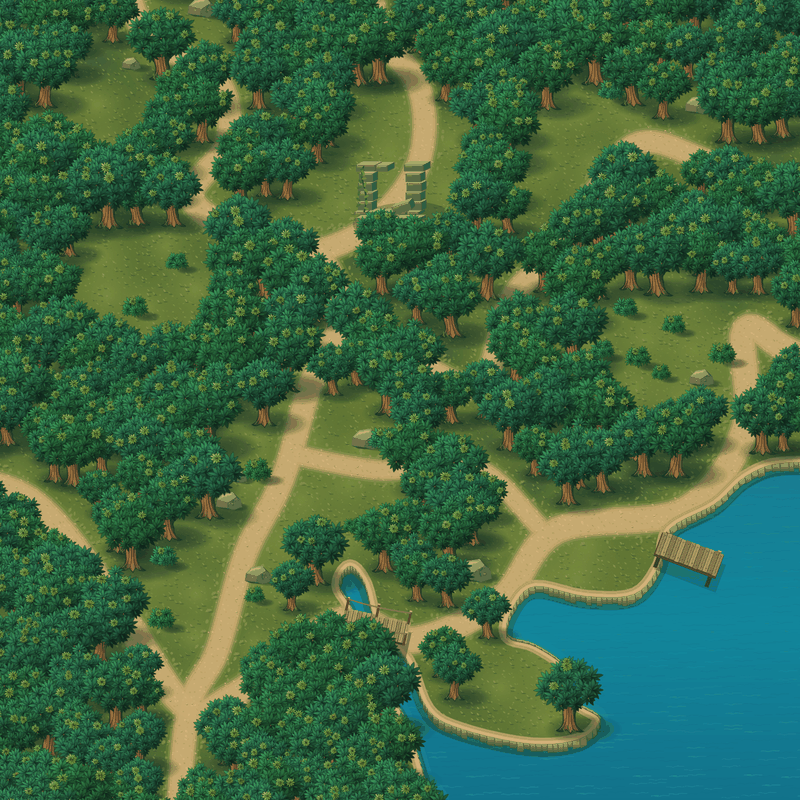

# Engine — программная графика и PNG

Редактор предметов и основа движка в ветке `engine`, основан на `master` v0.6.9 (`214fda6`). Устройство и управление — [Engine: как устроена карта](engine.md).

## Открыть

```sh
npm ci
npm run dev:local
```

Перейти на `http://localhost:3000/engine`. Прежний маршрут `/prototype/procedural-forest` также работает. Оба маршрута помечены `noindex`.

Если рабочая копия создана через `git worktree add ... origin/work/procedural-forest-test`, она остаётся на коммите, выбранном при создании. Для перехода на `engine` и последующих обновлений остановить dev-сервер и из этой рабочей копии выполнить:

```sh
git fetch origin
git switch --detach origin/engine
npm run dev:local
```

Кнопки редактора отключают восстановление браузером атрибута `disabled` через `autocomplete="off"`. Это предотвращает несовпадение серверного HTML и состояния React при возврате на страницу в Firefox. Нативная блокировка кнопок во время подготовки карты сохраняется.



Превью документации уменьшено до 800×800; размер самой карты и её PNG-экспорта сохраняется.

## Как менять карту без кода

1. Нажать **«Выбрать»**, затем нажать на дерево, куст, камень, руины, мост, причал или PNG-картинку. Предмет выделится рамкой.
2. Перетащить выбранный предмет по карте. Чтобы изменить размер, потянуть одну из четырёх угловых ручек; пропорции сохраняются, противоположный угол остаётся на месте. В правой панели «Предмет» можно задать имя, слой, X, Y, размер в процентах и поворот в градусах. Введённое число применяется по Enter или при уходе из поля.
3. Для дерева, куста и камня выбрать один из 24 вариантов внешнего вида. Кнопки **«Дублировать»** и **«Удалить объект»** работают со всеми семью видами предметов.
4. Открыть палитру рядом с инструментами на карте, выбрать предмет, затем нажать на карту. Он попадёт в активный слой. Деревья и кусты добавляются на подходящую землю; камни, руины, мост, причал и PNG допускают свободную расстановку внутри карты. Перемещение уже существующего предмета также свободное.
5. **«Отменить» / «Повторить»** возвращают изменения. Одно перетаскивание считается одним действием. Можно отменить расширение, сброс, смену seed и импорт сцены; история хранит до 60 действий в текущем сеансе.

Инструменты: `V` — выбор, `H` — обзор, `B` — добавление, `E` — удаление. `1`…`6` выбирают тип предмета из палитры, `7` открывает выбор PNG-файла. Пробел временно включает перемещение карты; также работает средняя кнопка мыши. Shift при перетаскивании ограничивает движение одной осью; у края окна карта прокручивается автоматически. Стрелки двигают выбранный предмет на одну единицу, Shift + стрелки — на десять. Delete/Backspace удаляет, Escape отменяет незавершённый перенос или снимает выбор. Ctrl/⌘ + D дублирует; Ctrl/⌘ + Z и Ctrl/⌘ + Shift + Z отменяют и повторяют.

Горячие клавиши работают в редакторе, включая фокус на кнопках, и по физическим клавишам в русской раскладке. Поля ввода, выпадающие списки и редактируемый текст сохраняют обычное управление. Для обзора карты также можно перетаскивать пустое место; колесо и жест двумя пальцами изменяют масштаб, `0` показывает всю карту.

На телефоне предмет также выбирается и перемещается пальцем. Жест двумя пальцами или прерывание перетаскивания отменяют незавершённое перемещение, сохраняя последнюю законченную расстановку.

## Управлять перекрытием и предметами

Открыть правую панель **«Слои»** или нажать `L`. Слои и предметы показаны от переднего к заднему: верхняя строка рисуется поверх нижней. В исходной сцене есть «Передний план», «Мир» и «Задний план». Слои можно добавлять, переименовывать, переставлять, скрывать и блокировать. «Мир» обязателен; удаление другого слоя переносит его предметы в «Мир», не удаляя их.

Нажатие строки выбирает предмет, даже если его закрывают другие. Поиск находит имя, вид или ID. Значки видимости и замка управляют отдельным предметом. Скрытые предметы остаются в сцене и списке, но не попадают на карту и в PNG. Заблокированные видны, но защищены от переноса, изменения размера и удаления; их можно разблокировать в списке.

Перетаскивание строки и команды порядка в панели «Предмет» задают перекрытие внутри слоя. `Ctrl/⌘ + ]` и `Ctrl/⌘ + [` сдвигают на один шаг; с Shift — в край слоя. «Авто» возвращает зависимость перекрытия от положения на карте. Выбор слоя в параметрах переносит туда предмет. `F` находит выбранный предмет на карте и подбирает масштаб. Эти команды входят в undo/redo и автосохранение.

## Как сохранять и переносить работу

| Действие | Результат |
|---|---|
| Изменить предмет | Законченное действие автоматически сохраняется в этом браузере и восстанавливается после перезагрузки |
| «Скачать сцену» | JSON с seed, шириной, слоями, состояниями и порядком предметов, правками и встроенными PNG; его можно открыть и продолжить редактировать на другом компьютере |
| «Открыть сцену» | Загрузить сохранённый JSON на этом или другом компьютере; невалидный файл не заменяет текущую карту |
| «Скачать PNG» | Готовый рисунок всей открытой карты с правками, без сетки и рамки выбора |
| «Растительность» | Временно скрыть или показать деревья и кусты; камни и постройки остаются доступны |

Сцена сохраняется отдельно от сохранений основной игры. Автосохранение привязано к браузеру и адресу приложения; для переноса между компьютерами или адресами нужен JSON. Когда браузер запрещает сохранение или исчерпал место, интерфейс предлагает скачать сцену. Текущая версия — 3; версии 1 и 2 мигрируют автоматически. Ограничения: файл до 32 МиБ, до 32 слоёв, до 5000 добавленных предметов, масштаб 10–800%, поворот −180°…180°, координаты добавленных предметов внутри открытой карты. История отмены и положение камеры не входят в JSON.

## Встроить PNG

**«Загрузить PNG»** или `7` открывает выбор файла. Картинка размещается в центре видимой карты, выделяется и готова к переносу и изменению размера. Уже загруженные изображения можно повторно ставить из списка, а выбранный предмет — дублировать. **«Дом 1 уровня»** добавляет исходный PNG дома без изменений. Его программная версия удалена.

PNG встроены в JSON-сцену версии 3. Скачать сцену и открыть её в другом браузере достаточно для переноса изображений вместе с предметами и слоями. Старые сцены версии 2 сохраняют PNG; версия 1 сохраняет остальные правки и открывается без удалённого программного дома. Изменение размера не ухудшает исходный файл. PNG-экспорт карты включает видимые импортированные картинки без выделения и ручек.

Один PNG: до 5 МиБ, сторона до 4096 px. Сцена: до 32 картинок, до 16 МиБ исходных файлов и до 32 миллионов пикселей суммарно; JSON до 32 МиБ. При исчерпании места автосохранения нужно скачать сцену — предметы остаются в текущем редакторе. Ошибка загрузки или неверная сцена не заменяет законченную работу.

## Что проверяем

Можно ли передать объём нарисованного леса через Canvas 2D и хранить мир как отдельные элементы. Земля, трава, тропы, вода, берег, деревья, кусты, камни, руины, мост и причал рисуются программно. Собственные PNG добавляются как отдельные предметы с исходным рисунком и прозрачностью; сетевые текстуры и генерация изображений не используются. Кроны состоят из освещённых листьев и перекрывающихся масс; корни и тени связывают дерево с землёй.

Карта начинается с 1600×1600 и раскрывается вправо двумя шагами по 800 до 3200×1600. Геометрия троп и берега задана в мировых координатах; растительность зависит от seed и координат ячейки. Размер открытой карты не участвует в генерации объектов. За границей учитываются соседние кроны и тени, поэтому расширение сохраняет существующий рисунок.

Предметы существуют независимо от нарисованной земли: изменение или удаление предмета сохраняет фон под ним. `Enter` на карте применяет инструмент добавления или удаления в центре экрана. Форма троп, берега и воды пока описана координатами в `layout.ts`; кистей рельефа в интерфейсе нет.

## Где менять

Все модули находятся в `features/world/dev/procedural-forest/`:

| Файл | Ответственность |
|---|---|
| `layout.ts` | Тропы, берег, поляны, выборка типа земли, координатный hash |
| `terrain.ts` | Текстуры земли, песка и воды, объём берега |
| `foliage.ts` | Отдельные деревья и кусты; 24 используемых варианта |
| `objects.ts` | Семь видов предметов, исходная расстановка, точки опоры, глубина, границы и выбор повёрнутых объектов |
| `stacking.ts` | Слои, видимость, блокировка и ключи ручного порядка перекрытия |
| `props.ts` | Камни, руины, мост, причал |
| `image-assets.ts` | PNG: исходные байты, формат, размеры, идентификатор и ограничения |
| `renderer.ts` | Земля участками 512×512, кэш программной графики и PNG, видимые слои и ручной порядок, рамка и ручки выбора |
| `controller.ts` | Камера, жесты, команды предметов/слоёв, расширение, JSON и PNG |
| `transform.ts` | Ручки выбора, изменение размера с сохранением пропорций и противоположного угла |
| `editor-scene.ts` | Версия данных сцены, валидация, история отмены и локальное сохранение |
| `editor-inspector.tsx` | Поля координат, масштаба, поворота и варианта предмета |
| `workspace-inspector.tsx` | Имя, слой, ручной порядок, видимость, блокировка и поиск выбранного на карте |
| `workspace-layers.tsx` | Слои, поиск, виртуальный список предметов, перетаскивание порядка |
| `editor-button.tsx` | Кнопки с защитой от восстановления старого состояния `disabled` в Firefox |
| `procedural-forest-preview.tsx` | Экран проверки и соседний CSS module |

Рендер обновляется при изменении камеры, размера окна или данных. Постоянного анимационного цикла нет. Кэши создаются для видимой земли и вариантов объектов, освобождаются при уходе со страницы; смена seed очищает землю. Плотность canvas ограничена DPR 2.

## Границы эксперимента

Это не WFC и не бесконечный генератор рельефа: схема троп, полян и воды нарисована координатами до предела тестового мира. Seed меняет растительность и фактуру на этой схеме. Для бесконечного мира нужен отдельный генератор связной геометрии.

Внешний вид стилизован и не воспроизводит исходный макет точно. Игровые здания, герой, навигация, столкновения, экономика, день/ночь и сохранения основной игры не подключены. Смена seed сбрасывает расстановку, но действие можно отменить. Рельеф ещё не редактируется через интерфейс. Поворот предмета — вращение его 2D-рисунка относительно исходной ориентации, а не смена ракурса 3D-модели.

## Проверки

- `npm run typecheck`, `npm run architecture:check`, `npm run lint` — проходят.
- `node --test tests/procedural-forest*.test.mjs` — 98/98: детерминизм и расширение; слои/ручной порядок/совпавшие позиции, блокировки, видимость, имена, миграция v2 и экспорт большого JSON; все семь видов предметов, изменённые координаты, поворот, глубина и границы; JSON, история отмены, горячие клавиши, временное перемещение, прокрутка у края, жесты контроллера, импорт и сбои сохранения; PNG: исходные байты, переносимый JSON, асинхронная загрузка/экспорт, ограничения, кэш и повреждённые файлы, включая корректные заголовки с неверными пикселями; resize: все углы, поворот/зум, края мира, отмена, маленькие предметы и один шаг истории.
- Chromium: выбор, изменение параметров, перетаскивание, дублирование и удаление; все шесть видов предметов в палитре; отмена/повтор; автосохранение после перезагрузки; JSON-перенос и отказ без потери правок при неверном файле; PNG без рамки/сетки; экран 1440×1050 и мобильные 390/320 px, touch и reduced motion. Ошибок страницы и горизонтального переполнения нет.
- Firefox без расширений: исходная ошибка гидратации воспроизведена на back-навигации; после защиты кнопок проверены первичная загрузка, reload, back/forward и сохранённая сцена — ошибок гидратации нет. Chromium: выбор предмета, координаты и восстановление после reload также проходят.
- Этап `engine`: `/engine` и прежний маршрут; клавиши с русской раскладкой и фокусом на панели, сохранение ввода текста, пробел/средняя кнопка, точка захвата, Shift-ось, прокрутка при неподвижном указателе у края, Ctrl/⌘+D, одна запись на перенос, отмена при Escape/blur/cancel, мобильные 390/320 px и Firefox back. Ошибок гидратации, страницы и переполнения нет.
- Этап слоёв: Chromium и Firefox проверили точные пиксели перекрытия в PNG, передний/задний порядок, DnD и перенос между слоями, видимость и замки, undo/redo, JSON v3 в чистом браузере и reload, миграцию v2 без изменений PNG/параметров, поиск, удалённый фильтр слоя, F/L и клавиатурные вкладки без случайного переноса предмета. Исходный PNG дома сохранён побайтно; повёрнутый resize сохраняет противоположный угол и одну запись истории. Chromium 390/320 px: touch resize, назначение слоя, порядок, видимость/замки и панель; переполнения и ошибок страницы/гидратации нет.
- Этап PNG и resize: Chromium/Firefox проверили исходные байты дома, размещение/галерею/клавишу 7, все углы повёрнутого предмета и zoom, пропорции/противоположный угол, один undo/save, отмену и сохранение ввода. PNG-экспорт совпадает с исходным рисунком в проверенных пикселях; перенос встроенных PNG через JSON в чистый браузер и reload проходят. Старый дом удаляется при миграции v1 без потери остальных правок. Битые PNG/JSON не заменяют сцену; при ошибке квоты можно скачать её из памяти. Touch/resize на 390/320 px без переполнения, ошибок страницы/гидратации нет.
- Сравнение PNG 1600×1600 с той же областью после расширения до 3200×1600: геометрия и предметы сохранены; 8 пикселей у правого края отличаются на 1 значение цветового канала из-за растеризации Canvas, альфа совпадает.

Production-сборки и полный набор тестов игры не запускались: изменение изолировано в новом маршруте, это не выпуск. Деплой не выполнялся.
